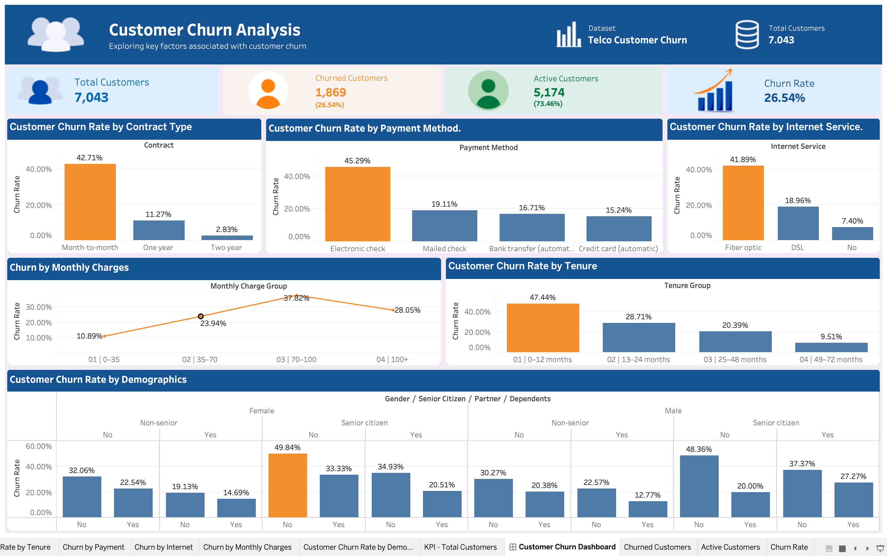
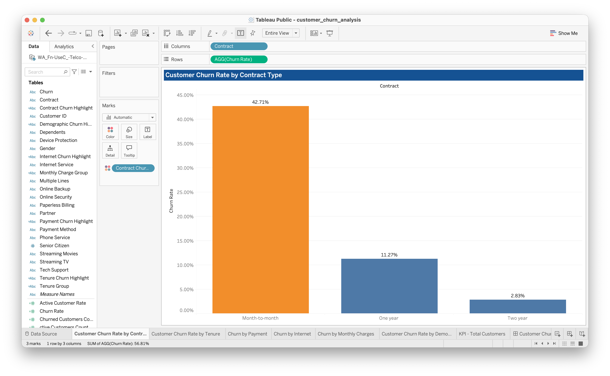
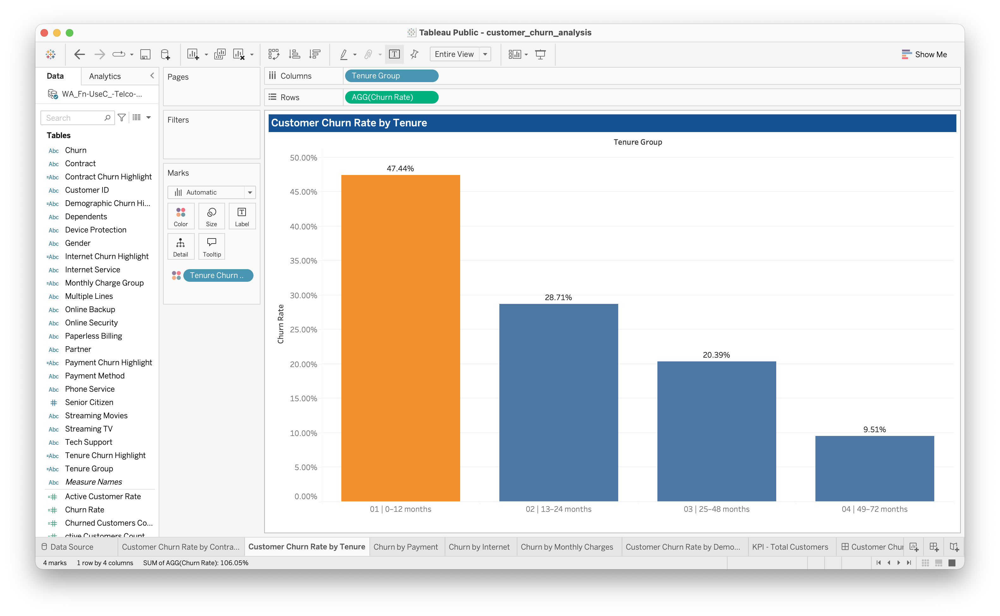
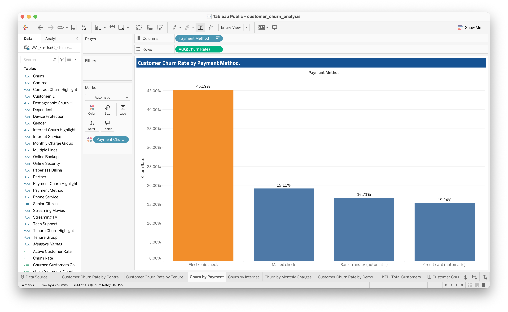
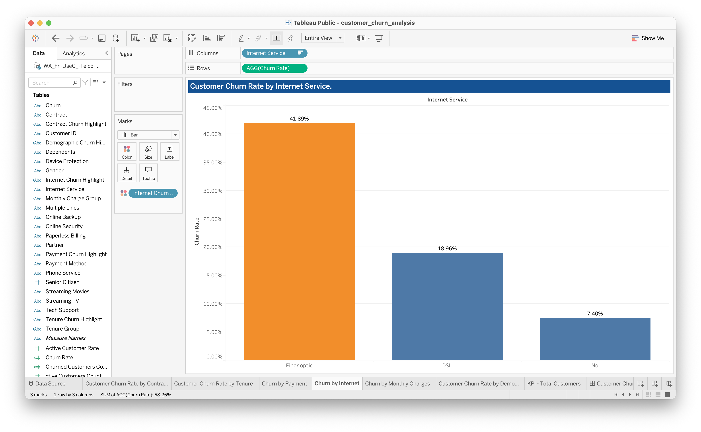
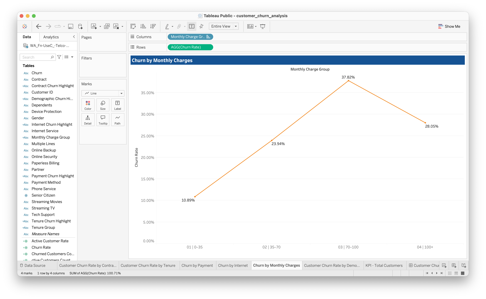
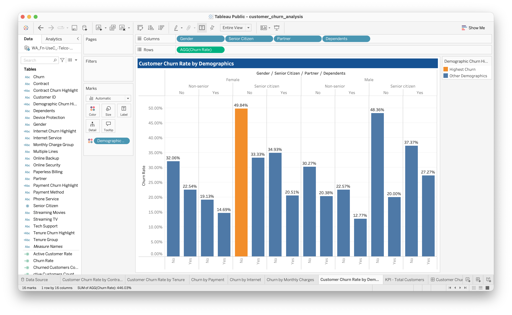

# Customer Churn Analysis

## Project Overview

This project analyzes customer churn in the telecommunications industry to identify patterns and customer characteristics associated with service cancellations. Using Python for data cleaning, exploratory data analysis (EDA), and visualization, alongside Tableau Public for dashboard development, the project investigates how contract types, customer tenure, payment methods, internet services, monthly charges, and customer demographics relate to churn.

The goal is to translate data-driven findings into actionable recommendations that can help telecommunications businesses improve customer retention.

## Project Objectives

- Calculate the overall customer churn rate.
- Analyze churn patterns across contract types, tenure, and payment methods.
- Examine the relationship between monthly charges, subscribed services, and customer churn.
- Identify customer segments with higher observed churn rates.
- Develop evidence-based recommendations to support customer retention.
- Communicate key findings through a Tableau dashboard.

## Tools & Technologies

- **Python** — Data cleaning, exploratory data analysis, and churn rate calculations.
- **pandas** — Data manipulation, grouping, aggregation, and analysis.
- **Matplotlib** — Creating and exporting data visualizations.
- **Seaborn** — Statistical visualization, including heatmaps.
- **Jupyter Notebook** — Executing and documenting the Python analysis.
- **Visual Studio Code** — Development environment.
- **Tableau Public** — Interactive dashboard and visual analytics.
- **Git and GitHub** — Version control and project publishing.

## Dataset

This project uses the IBM Telco Customer Churn dataset, which contains customer demographics, subscribed services, contract details, billing information, tenure, and churn status.

- **Source:** [Telco Customer Churn Dataset on Kaggle](https://www.kaggle.com/datasets/blastchar/telco-customer-churn)
- **Records:** 7,043 customers
- **Fields:** 21 columns

The dataset was inspected for data quality issues, including duplicate records and missing values. The 11 missing values in `TotalCharges` were retained as missing because they corresponded to customers with zero tenure and no recorded churn.

## Methodology

1. **Data inspection:** Reviewed the dataset's structure, data types, and completeness.
2. **Data quality checks:** Checked for duplicate records and examined missing values.
3. **Exploratory data analysis:** Investigated churn distributions and customer characteristics.
4. **Churn rate analysis:** Calculated overall and segment-level churn rates.
5. **Visualization:** Created charts to compare churn patterns across customer groups.
6. **Dashboard development:** Developed a Tableau dashboard to communicate key metrics and findings.
7. **Business interpretation:** Developed preliminary recommendations based on the observed patterns.

## Python Analysis and Key Findings

The Python exploratory data analysis included customer-level data checks, overall churn calculations, and comparisons across customer segments.

### Overall Churn

Of the 7,043 customers in the dataset, **1,869 churned**, while **5,174 remained**.

- **Overall churn rate:** 26.54%
- **Customers who churned:** 1,869 (26.54%)
- **Customers who remained:** 5,174 (73.46%)

### Segment-Level Findings

**1. Contract Type**

Month-to-month customers had the highest observed churn rate at **42.71%**, compared with **11.27%** for one-year contracts and **2.83%** for two-year contracts. Churn rates were substantially lower among customers with longer-term contracts.

**2. Customer Tenure**

Customers with **0–12 months** of tenure had the highest observed churn rate at **47.44%**. The rate declined across the tenure groups, reaching **9.51%** among customers with **49–72 months** of tenure. This pattern highlights the first year of service as an important period for further retention analysis.

**3. Payment Method**

Customers using electronic checks had the highest observed churn rate at **45.29%**. The rates were lower for mailed checks (**19.11%**), automatic bank transfers (**16.71%**), and automatic credit card payments (**15.24%**). Further analysis would be needed to determine why these differences exist.

**4. Internet Service**

Fiber optic customers had an observed churn rate of **41.89%**, compared with **18.96%** for DSL customers and **7.40%** for customers without internet service. These differences warrant further investigation into pricing, service quality, customer expectations, and other potentially relevant factors.

**5. Additional Services**

Customers without online security had a churn rate of **41.77%**, compared with **14.61%** among customers subscribed to the service. Similarly, customers without tech support had a churn rate of **41.64%**, compared with **15.17%** among customers with tech support. These associations suggest that service subscriptions are useful factors to investigate in customer retention analysis, but they do not establish that the services themselves prevent churn.

**6. Monthly Charges**

Customers who churned had higher average monthly charges (**74.44**) than customers who remained (**61.27**). Churn rates also differed across monthly charge groups:

- **0–35:** 10.89%
- **35–70:** 23.94%
- **70–100:** 37.82%
- **Above 100:** 28.05%

The 70–100 group had the highest observed churn rate among these charge groups. The pattern is not strictly increasing, so monthly charges should be examined alongside contract types and subscribed services rather than treated as an independent explanation for churn.

**7. Customer Demographics**

Senior citizens had an observed churn rate of **41.68%**, compared with **23.61%** for non-senior customers. Customers without partners had a rate of **32.96%**, compared with **19.66%** for customers with partners. Customers without dependents had a rate of **31.28%**, compared with **15.45%** for customers with dependents. Churn rates by gender were relatively similar: **26.92%** for female customers and **26.16%** for male customers.

These findings describe associations in the dataset and do not establish that any particular factor directly causes customer churn. Rates for specific demographic combinations should also be interpreted in the context of the number of customers in each subgroup.

## Tableau Dashboard

The Tableau dashboard brings together key churn metrics and segment-level comparisons.



The packaged Tableau workbook is available at `tableau/customer_churn_analysis.twbx`. It contains the dashboard and supporting worksheets used to explore customer churn patterns.

### Supporting Visualizations

**Churn by Contract Type**



**Churn by Customer Tenure**



**Churn by Payment Method**



**Churn by Internet Service**



**Churn by Monthly Charges**



**Churn by Demographics**



## Business Recommendations

Based on the exploratory findings, the following actions could be investigated:

- **Improve early customer retention:** Strengthen onboarding, customer engagement, and support during the first year of service.
- **Review contract strategies:** Investigate why month-to-month customers churn more frequently and evaluate appropriate longer-term contract incentives.
- **Investigate fiber optic churn:** Examine customer feedback, service quality, pricing, and expectations among fiber optic subscribers.
- **Review payment experiences:** Investigate whether electronic check users encounter payment-related friction and evaluate convenient alternative payment options.
- **Evaluate additional services:** Assess the perceived value and accessibility of online security and technical support services.
- **Investigate pricing and service combinations:** Explore how monthly charges, contract types, and subscribed services interact with churn behavior.

These recommendations should be evaluated using additional analysis and customer feedback before implementation.

## Project Structure

```text
customer-churn-analysis/
├── data/
│   └── WA_Fn-UseC_-Telco-Customer-Churn.csv
├── images/
│   ├── churn-by-contract.png
│   ├── churn-by-demographics.png
│   ├── churn-by-internet-service.png
│   ├── churn-by-monthly-charges.png
│   ├── churn-by-payment-method.png
│   ├── churn-by-tenure.png
│   └── customer-churn-dashboard.png
├── python/
│   ├── charts/
│   │   ├── churn_heatmap_contract_internet.png
│   │   ├── churn_rate_by_contract.png
│   │   ├── churn_rate_by_demographics.png
│   │   ├── churn_rate_by_internet.png
│   │   ├── churn_rate_by_monthly_charge.png
│   │   ├── churn_rate_by_payment.png
│   │   ├── churn_rate_by_tenure.png
│   │   └── churn_rate_security_tech_support.png
│   └── analyze_churn.ipynb
├── tableau/
│   └── customer_churn_analysis.twbx
└── README.md
```

The `data/` directory contains the original dataset. The `images/` directory contains the images used in this README. The `python/` directory contains the Jupyter notebook and exported analytical charts in `python/charts/`. The `tableau/` directory contains the packaged Tableau workbook.

## Future Improvements

- Publish or share the Tableau dashboard online where appropriate.
- Further investigate interactions between contract type, tenure, monthly charges, and subscribed services.
- Validate observed patterns using additional statistical analysis.
- Refine business recommendations based on further analysis and customer feedback.
- Explore predictive modeling to identify customers at elevated risk of churn.

**## Author**
Eiron T. Batac
Bachelor of Science in Computer Science