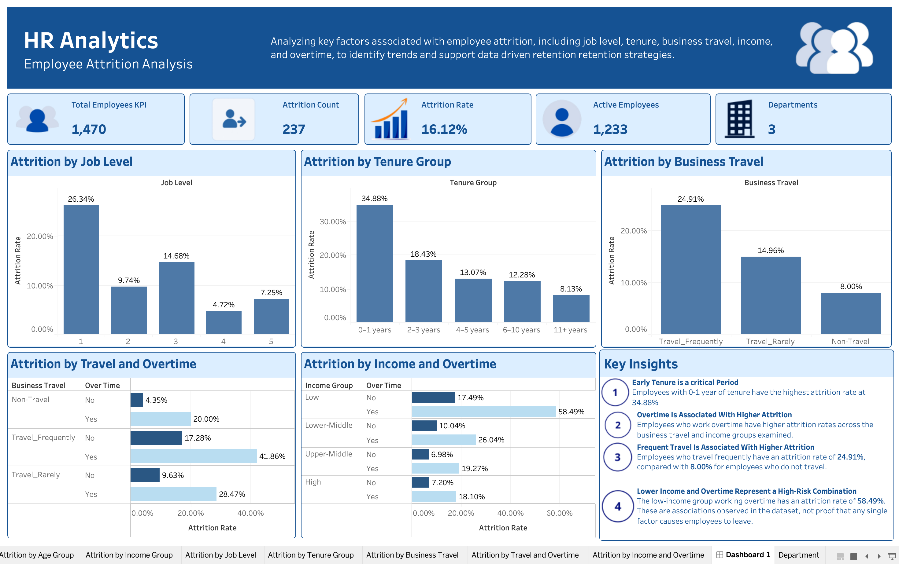
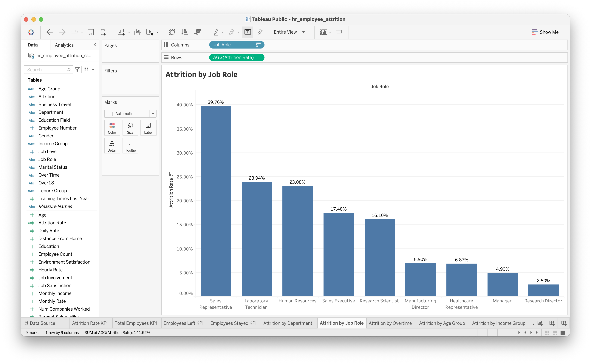
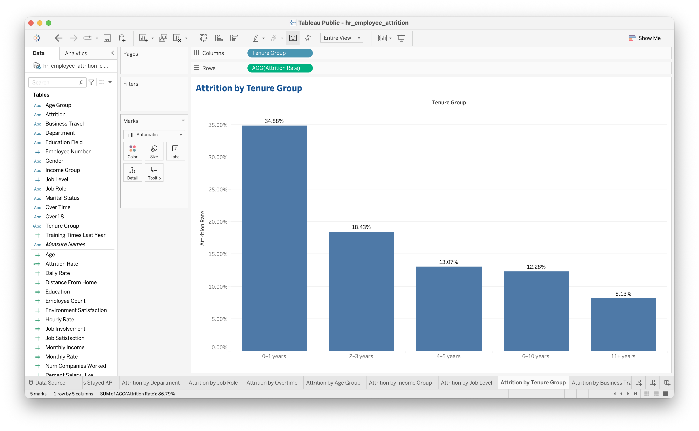
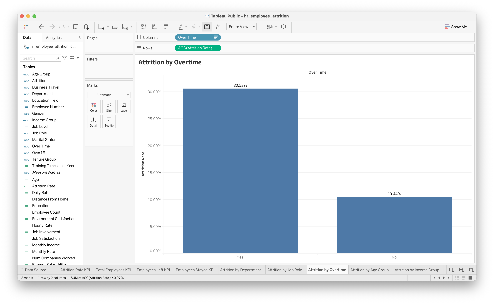
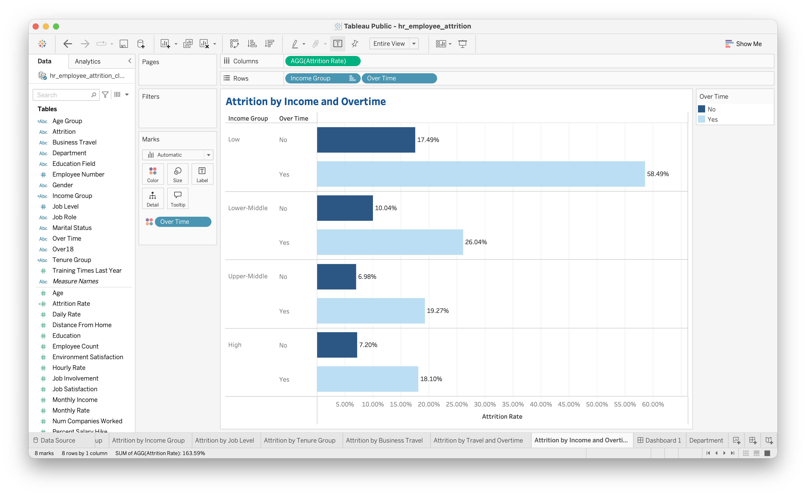
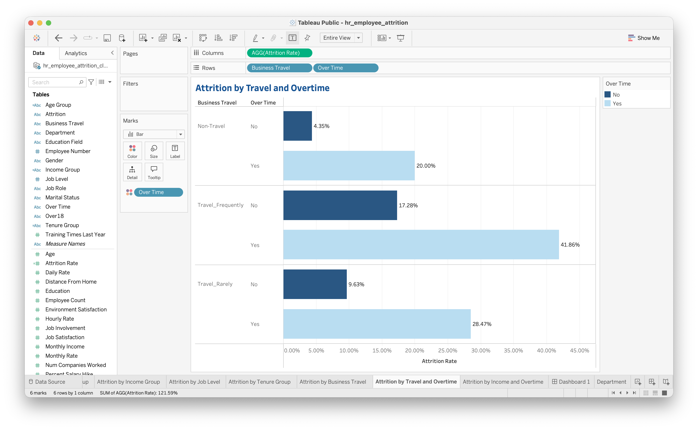

# HR Analytics — Employee Attrition Analysis

## Project Overview

This project analyzes employee attrition using the IBM HR Analytics Employee Attrition dataset. The goal is to identify workforce patterns associated with employees leaving the organization and translate the findings into actionable recommendations that may support employee retention.

Python and exploratory data analysis (EDA) are used to examine attrition across employee demographics, job characteristics, compensation, tenure, overtime, satisfaction, and business travel. MySQL is used to perform structured queries and compare attrition rates across employee groups. Tableau is used to present key findings through a dashboard saved locally in Tableau.

## Business Problem

Employee turnover can affect workforce stability, recruitment costs, and organizational productivity. Understanding which employee groups have higher attrition rates can help organizations investigate potential retention risks and prioritize further analysis.

This project addresses the following questions:

- What is the overall employee attrition rate?
- Which departments and job roles have higher attrition rates?
- How are age, income, job level, and tenure associated with attrition?
- How do overtime, job satisfaction, work-life balance, and business travel relate to attrition?
- Which employee groups may warrant further investigation and targeted retention initiatives?

## Dataset

The project uses the IBM HR Analytics Employee Attrition dataset.

- **Records:** 1,470 employees
- **Columns:** 35
- **Target variable:** `Attrition` (`Yes` or `No`)
- **Missing values:** None identified during initial inspection
- **Duplicate rows:** None identified during initial inspection

The dataset includes employee demographics, job information, compensation, tenure, job satisfaction, work-life balance, overtime, and business travel.

Two CSV files are retained in the project:

- `WA_Fn-UseC_-HR-Employee-Attrition.csv` — the original dataset used for Python analysis.
- `hr_employee_attrition_clean.csv` — an import-compatible copy prepared for loading the dataset into MySQL.

The import-compatible copy was created to address the original CSV's MySQL import issue.

## Tools and Technologies

- **Python** — data inspection and exploratory analysis
- **Pandas** — data manipulation and aggregation
- **Matplotlib and Seaborn** — data visualization
- **Jupyter Notebook** — analysis workflow
- **MySQL** — SQL queries and employee attrition analysis
- **VS Code** — development environment
- **Tableau** — dashboard development and data visualization
- **Git and GitHub** — version control and project hosting

## Methodology

1. **Data inspection:** Reviewed dataset dimensions, column types, missing values, duplicate records, and constant-value columns.
2. **Data preparation:** Examined data suitability for analysis and created derived groups for selected variables.
3. **Python exploratory data analysis:** Calculated attrition counts and rates across demographic, job-related, compensation, and workplace factors.
4. **SQL analysis:** Developed queries to summarize overall attrition and compare departments, job roles, overtime, age groups, income groups, job levels, tenure, business travel, satisfaction, work-life balance, and selected combinations of factors.
5. **Data visualization:** Created Tableau worksheets and a dashboard to communicate the main findings.
6. **Business interpretation:** Summarized notable patterns and developed recommendations based on the observed results.

## Key Findings

### Python Analysis — Exploratory Data Analysis

Python was used to inspect the dataset and explore attrition patterns across employee groups.

- **Dataset quality:** The dataset contained 1,470 employee records and 35 columns. Initial inspection identified no missing values or duplicate rows.
- **Overall attrition:** 237 employees left the organization and 1,233 stayed, giving an overall attrition rate of **16.12%** and a retention rate of **83.88%**.
- **Tenure:** Employees with 0–1 years at the company had an attrition rate of **34.88%**, compared with **8.13%** for employees with 11 or more years of tenure. Employees who left also had lower average tenure than those who stayed.
- **Overtime:** Employees who worked overtime had an attrition rate of **30.53%**, compared with **10.44%** among employees who did not work overtime.
- **Age:** Employees under 25 had the highest attrition rate among the analyzed age groups, at **39.18%**. The 25–34 age group had an attrition rate of **20.22%**, while the rates for employees aged 35–44 and 45–54 were approximately 10%.
- **Income:** The low-income group had an attrition rate of **29.27%**, compared with **10.33%** for the high-income group. Employees who left also had lower average and median monthly income than employees who stayed.
- **Job role:** Sales Representatives had the highest job-role attrition rate, at **39.76%**. Laboratory Technicians also had a relatively high rate of **23.94%**.
- **Job satisfaction:** Employees with a job satisfaction rating of 1 had an attrition rate of **22.84%**, compared with **11.33%** among employees with a rating of 4.
- **Work-life balance:** The attrition rate was **31.25%** among employees with a work-life balance rating of 1. This was higher than the rates in the other rating groups.
- **Business travel and overtime:** Employees who traveled frequently and worked overtime had an attrition rate of **41.86%**. Employees who did not travel and did not work overtime had a rate of **4.35%**.

### SQL Analysis — MySQL Query Findings

MySQL queries were used to calculate and compare attrition counts and rates across workforce groups, providing structured results to complement the Python exploration.

- **Department:** Sales had an attrition rate of **20.63%**, Human Resources had **19.05%**, and Research & Development had **13.84%**.
- **Job role:** Sales Representatives had the highest attrition rate at **39.76%**, followed by Laboratory Technicians at **23.94%** and Human Resources roles at **23.08%**.
- **Job level:** Employees at Job Level 1 had an attrition rate of **26.34%**, compared with **4.72%** at Job Level 4 and **7.25%** at Job Level 5.
- **Income group:** Attrition was **29.27%** in the low-income group and **10.33%** in the high-income group.
- **Tenure group:** The highest attrition was among employees with 0–1 years of tenure (**34.88%**), while the rate among employees with 11 or more years was **8.13%**.
- **Business travel:** Employees who traveled frequently had an attrition rate of **24.91%**, compared with **14.96%** among employees who traveled rarely and **8.00%** among employees who did not travel.
- **Income and overtime combined:** Employees in the low-income group who worked overtime had an attrition rate of **58.49%**, compared with **17.49%** for low-income employees who did not work overtime.
- **Travel and overtime combined:** Frequent travelers who worked overtime had an attrition rate of **41.86%**. The rate was **28.47%** for employees who traveled rarely and worked overtime, and **20.00%** for employees who did not travel but worked overtime.
- **Satisfaction and work-life balance:** SQL comparisons showed higher attrition among employees with the lowest job satisfaction and lowest work-life balance ratings than among most higher-rating groups.

### Overall Interpretation

Python exploration and SQL queries highlight recurring patterns: higher attrition among employees with shorter tenure, employees working overtime, younger employees, lower-income groups, and selected job roles and work-condition combinations. These patterns can help prioritize further investigation, but they do not establish that any individual factor caused employees to leave.

## Dashboard Preview

The Tableau dashboard summarizes selected employee attrition patterns identified in the analysis. It highlights differences across tenure, job roles, overtime, income groups, and business travel. The workbook is currently saved locally and has not been published to Tableau Public.

### Employee Attrition Dashboard



### Supporting Visualizations

**Attrition by Job Role**



**Attrition by Tenure**



**Attrition by Overtime**



**Attrition by Income and Overtime**



**Attrition by Travel and Overtime**



## Business Recommendations

Based on the exploratory findings, the following actions may be worth investigating:

- **Strengthen onboarding and early-tenure support:** Review onboarding, mentorship, training, and check-ins for employees during their first year.
- **Review overtime practices:** Examine overtime frequency, workload distribution, staffing levels, and scheduling to identify opportunities to reduce excessive workloads.
- **Investigate Sales Representative attrition:** Review role expectations, training, compensation, performance targets, and employee feedback.
- **Evaluate compensation patterns:** Assess whether compensation is competitive and equitable across roles and experience levels.
- **Examine frequent travel demands:** Review travel schedules, workload expectations, recovery time, and work-life balance for employees who travel frequently.
- **Investigate combined risk indicators:** Examine groups experiencing multiple potential risk indicators, such as low income and overtime, without assuming that these factors cause individual employees to leave.
- **Monitor employee satisfaction:** Use employee feedback and satisfaction surveys to identify potential workplace concerns.
- **Track retention metrics over time:** Monitor attrition by tenure, job role, department, overtime status, and income group to determine whether retention initiatives are associated with improvements.

These recommendations should be evaluated with additional organizational context and employee feedback before implementation.

## Project Structure

```text
hr-analytics-employee-attrition/
├── data/
│   ├── WA_Fn-UseC_-HR-Employee-Attrition.csv
│   └── hr_employee_attrition_clean.csv
├── images/
│   ├── attrition-by-income-and-overtime.png
│   ├── attrition-by-job-role.png
│   ├── attrition-by-overtime.png
│   ├── attrition-by-tenure.png
│   ├── attrition-by-travel-and-overtime.png
│   └── dashboard.png
├── python/
│   └── 01_hr_data_inspection.ipynb
├── sql/
│   ├── 01_overall_attrition.sql
│   ├── 02_department_attrition.sql
│   ├── 03_job_role_attrition.sql
│   ├── 04_overtime_attrition.sql
│   ├── 05_age_group_attrition.sql
│   ├── 06_income_group_attrition.sql
│   ├── 07_job_level_attrition.sql
│   ├── 08_tenure_attrition.sql
│   ├── 09_business_travel_attrition.sql
│   ├── 10_job_satisfaction_attrition.sql
│   ├── 11_work_life_balance_attrition.sql
│   ├── 12_travel_overtime_attrition.sql
│   └── 13_income_overtime_attrition.sql
├── tableau/
│   └── hr_employee_attrition.twbx
└── README.md
```

## How to Explore the Project

1. Review the Jupyter Notebook in `python/` to follow the data inspection and exploratory analysis.
2. Open the SQL scripts in `sql/` to examine the queries used to analyze employee attrition.
3. View the screenshots in `images/` for the main visualizations and dashboard.
4. Open the locally saved Tableau workbook in `tableau/` using Tableau Desktop or another compatible Tableau application.

## Limitations

This analysis uses a single employee dataset and primarily examines descriptive patterns. The findings do not establish causation, and the dataset may not represent the conditions of other organizations. The analysis also does not incorporate additional organizational context, employee interviews, or follow-up data that could explain why employees left.

Further investigation, additional context, and validation would be needed before using these patterns to guide real-world employment decisions.

## Author

**Eiron T. Batac**
Bachelor of Science in Computer Science